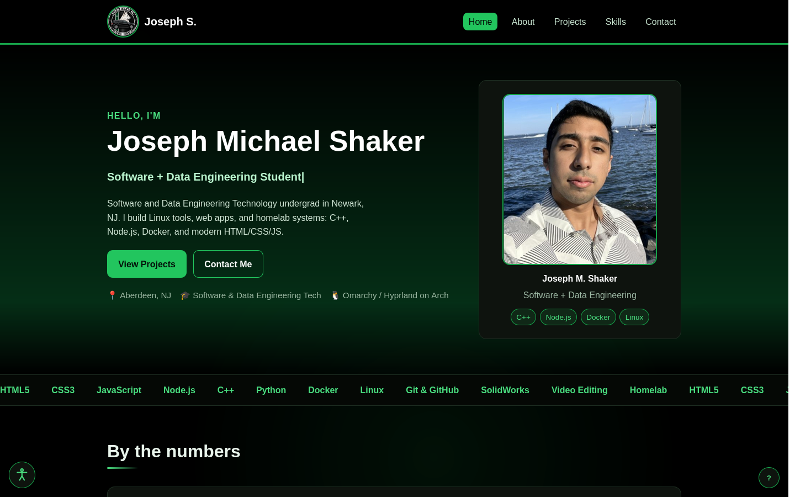

# Submission report: Personal Portfolio Website

- **Live website:** https://fiercejojo88862.github.io/Personal-Portfolio-Website/index.html
- **Code repository:** https://github.com/Fiercejojo88862/Personal-Portfolio-Website

Joseph Michael Shaker. B.S. Software and Data Engineering Technology, Newark, NJ.

## 1. Overview of the website's features

Five required pages, plus three case-study pages and a hidden video embed used by
the terminal.

**Content and structure**

- `index.html`: hero with headshot, "by the numbers" stats, a car-style telemetry
  cluster, an interactive terminal, three featured projects, and a contact call
  to action.
- `about.html`: background, story, principles, everyday kit, homelab service
  status, and hobbies.
- `projects.html`: project carousel, GitHub repository cards, and build notes
  with the gotchas behind each project.
- `skills.html`: languages, systems and tools, practices, and a now/next/later
  roadmap.
- `contact.html`: contact details and a validated contact form.
- `project-lock-studio.html`, `project-homelab.html`, `project-lubelogger.html`:
  one case study per featured project.

Every page shares the same primary navigation (Home, About, Projects, Skills,
Contact), a skip link, one `<h1>`, a valid heading order, and full metadata
(canonical, Open Graph, Twitter Card, JSON-LD `Person`).

**Responsive design**

- One hand-written stylesheet with breakpoints at 900px, 760px, and 620px, plus
  component-level media queries for the telemetry gauges, repository grid, and
  project carousel.
- Layout verified from 1440px down to 320px; the nav collapses to a hamburger
  menu under 760px and grids collapse to a single column.

**JavaScript features**

- **Garage telemetry:** odometer counts visits through a serverless hit counter,
  the speedometer needle follows scroll depth and coasts back to zero, the
  tachometer counts pages seen this session, and the fuel gauge shows how much of
  the five-page site you have explored.
- **Interactive terminal:** real commands (`help`, `about`, `projects`, `skills`,
  `contact`, `clear`) with argument handling, command history, and easter eggs
  (`cat cat` opens a hidden player page).
- **Project carousel** with previous/next controls, keyboard arrows, and slide
  announcements.
- **Keyboard shortcuts:** `1`-`5` jump between pages, `/` focuses search, `?`
  opens the shortcut help overlay.
- **Contact form validation** with inline errors, `aria-describedby` wiring, and a
  live-region status message.
- **Email obfuscation:** the address renders as `josephshaker2020[at]aol[dot]com`
  and the `mailto:` link is assembled on click.

**Accessibility**

- Skip link, visible `:focus-visible` rings, landmarks, labelled form controls,
  descriptive alt text on every image, and `prefers-reduced-motion` support.
- An Alt+A preferences panel that toggles larger text, high contrast, link
  underlines, readable body text, and paused motion, persisted in
  `localStorage`.
- All interactive widgets are keyboard operable and the content is still readable
  with JavaScript disabled.

## 2. Challenges faced and how I overcame them

**The telemetry digits rendered blank.** The odometer is built from digit wheels,
each holding a 0-9 strip that should slide inside a window. The first build
appended ten cells to each wheel and then translated only the first cell, so the
strip never moved and every value from 1 to 9 showed an empty window. I fixed it
by wrapping each strip in a `.odo-stack` element and translating the stack
instead, which is the element that actually needs to roll.

**The speedometer latched at its maximum.** It tracked the deepest scroll point
reached and stayed there, so the needle never came back down. Rewriting it as a
target plus a smoothed display value, with a 450ms timer that sets the target back
to zero, gives the needle a quick rise and a slow coast, which reads like a real
gauge.

**A "security" feature that hurt usability.** The obfuscated email looked good in
the source but gave visitors nothing to click. The compromise was to keep the
obfuscated text visible and build a real `mailto:` link only when the element is
clicked, which keeps scrapers from harvesting a plain address while still
letting a visitor send mail in one click.

**Rewriting accessibility without breaking the design.** Promoting every page
title to `<h1>` left the card headings starting at `<h3>`, a skipped level. A
plain tag swap made the cards render as oversized section titles, so I promoted
the affected cards to `<h2 class="h-compact">` and added one small rule that keeps
their original card scale. Screen readers now get a clean outline and the design
is unchanged.

**Keeping one page alive as five.** Every page loads the same nav, footer, and
scripts, so a fix in one place has to reach all five. I kept shared behaviour in a
single `script.js` driven by a per-page constant, which is what let the telemetry,
shortcuts, and accessibility panel work everywhere without duplicating code.

## 3. One example of Codex making a mistake and how I fixed it

**The mistake.** When Codex built the telemetry cluster it created the odometer
wheels and the update function together. The markup put ten digit cells directly
inside each wheel, but the update function translated `wheel.querySelector('span')`,
which returns only the *first* digit. The result was an odometer that looked
correct in code review and completely broken in the browser: a visit count of 1
showed an empty window, because the digit it needed was sitting below the visible
1.5em strip and nothing ever moved it. The same commit left the speedometer
latching at the maximum scroll depth, because the value was stored as a running
maximum instead of a target that could come back down.

**How I found it.** I loaded the page in the browser and watched the counter after
a reload. The wheels were animating but the windows were blank, and the needle
stayed pinned after I scrolled back to the top.

**The fix** (commit `3c8697d`, "Fix odometer rolling digits and coast the
speedometer down when scrolling stops"):

- Wrap the ten digits in a `.odo-stack` element and translate the stack, with a
  fallback lookup so older markup still works.
- Replace the running maximum with `speedTarget`/`speedShown` and a paint loop
  that eases in fast and out slowly, plus a 450ms coast timer.
- Re-test by reloading twice, scrolling to the bottom and back, and confirming the
  digits roll and the needle returns to 0.

**Why it matters.** The failure was invisible in the diff and obvious in the
browser. The lesson I applied for the rest of the project: any generated
JavaScript that manipulates the DOM gets verified in the browser at desktop and
phone widths before it gets committed, which is now written into `AGENTS.md`.

## 4. Screenshots

**Laptop, 1440x900 (live site)**

**Phone, 390x844 (live site)**

## 5. Testing

The full test plan and recorded results are in [`TESTING.md`](TESTING.md): 40 checks
covering links and HTTP status, responsive layout at five widths, keyboard and
screen-reader accessibility, every JavaScript feature, and deployment.

Highlights from the last run against the live site: all nine pages return HTTP
200, every page has exactly one `<h1>` with no skipped heading levels, 30 images
all carry alt text, no local link is broken, keyboard-only navigation reaches
every page, and the console is free of errors.
